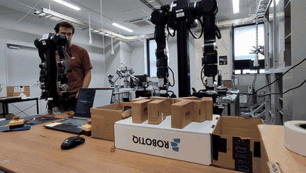
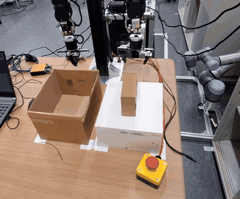

### Hi, I'm Louis 👋

Final-year engineering student at **Polytech Montpellier** (Microelectronics & Automation, robotics option), working on **robot learning for manipulation**:
imitation learning, reinforcement learning, and getting policies from simulation onto real robots.

📍 Montpellier, France · 🎯 Looking for a **6-month internship in Tokyo** (March – August 2027)

| Recording demonstrations | Policy running autonomously |
|:---:|:---:|
|  |  |
| Leader–follower teleoperation of the bimanual 7-DoF OpenArm (box-sorting task) | Imitation-learning policy on the real robot (a separate pick-and-place task) |
| *AIST Tokyo Waterfront, 2026* | *AIST Tokyo Waterfront, 2026* |

**Before** · 16-week research internship at **AIST Tokyo Waterfront** (Japan): imitation learning for a bimanual
box-sorting task on OpenArm 7-DoF arms.
→ [openarm-box-sorting](https://github.com/hcp-ai-hub/openarm-box-sorting) · [dataset & models on Hugging Face](https://huggingface.co/Louislerikiki)

- Brought the robot from a bare kit to a full record → train → evaluate pipeline (CAN FD, leader–follower teleoperation with force feedback, 6 RGB-D streams on custom 3D-printed mounts).
- Collected 100 teleoperated episodes (~249k frames) and compared **ACT, Diffusion Policy, VQ-BeT and π0** on the real robot.
- Built an offline dry-run diagnostic to separate model failures from hardware issues.

*Commits for this project were pushed from a shared lab workstation, so they don't appear in my contribution graph.*

**Now** · Final-year project: *Digital twin and AI for autonomous robotic manipulation* with a Franka Panda (with EuroDAO).
The simulation stage compares imitation learning and reinforcement learning on a pick-and-place task in MuJoCo,
before moving to Isaac Sim and the real robot.
→ [panda-pick-place-il-rl](https://github.com/LouisBarthez/panda-pick-place-il-rl)

  

On the real Panda: ROS 2 + MoveIt 2 (C++) driving the arm, with a legacy libfranka 0.8.0 / ROS 2 Foxy stack in Docker to match the robot firmware.
Cartesian impedance control validated in MuJoCo simulation (contour following on a 3D-printed part); porting to the real robot in progress.

#### Tools

#### Projects

| Project | What |
|---|---|
| [openarm-box-sorting](https://github.com/hcp-ai-hub/openarm-box-sorting) | Bimanual sort-by-weight on real OpenArm arms: ACT, Diffusion Policy, VQ-BeT, π0 + failure analysis |
| [panda-pick-place-il-rl](https://github.com/LouisBarthez/panda-pick-place-il-rl) | Pick-and-place with a Franka Panda in MuJoCo: behavior cloning from 2 cameras (50/50) vs SAC (49/50) |
| [Hugging Face](https://huggingface.co/Louislerikiki) | Datasets (100 episodes, 6 cameras) and trained policies from the AIST internship |
| [Perception](https://github.com/LouisBarthez/Perception) | Course lab (OpenCV): detecting and tracking an orange ping-pong ball in images and video (HSV thresholding, morphology, contours) |

#### Contact

[LinkedIn](https://www.linkedin.com/in/louis-barthez-29a476398/) · [Hugging Face](https://huggingface.co/Louislerikiki) · louis.barthez2206@gmail.com
